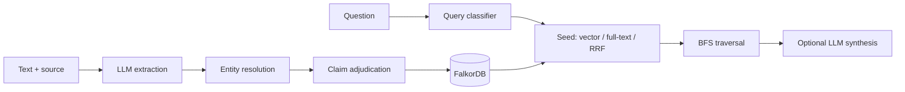

# GraphRAG Lab

A research testbed for GraphRAG: build a knowledge graph from text with an
LLM, then study how well different retrievers pull the right subgraph back
out for multi-hop questions.

The guiding question: **does the graph actually help, and can a learned
retriever choose better subgraphs than heuristics when the graph was built
by an LLM and is therefore noisy?** See the [research plan](docs/research-plan.md).

[](https://github.com/Pedro105/graphstore/actions/workflows/ci.yml)

## Status

| Milestone | State |
|---|---|
| 1. Cleanup: compose stack, CI, cached LLM client | Done |
| 2. Neo4j port + benchmark harness with baselines (2WikiMultiHopQA) | Next |
| 3. Learned GNN retriever (PyTorch Geometric) | Planned |
| 4. Robustness study under controlled graph noise | Planned |
| 5. Conflicting / evolving knowledge benchmark | Stretch |
| 6. Results report and interactive demo | Planned |

## What the system does today



- **Extraction:** structured LLM output with open-vocabulary relations and
  assertion semantics (asserted / terminated / negated, `as_of`).
- **Entity resolution:** embedding similarity plus exact-name matching, with
  type treated as a soft signal and merge candidates recorded.
- **Reified claims:** every fact is a `:Claim` node with status
  (`active` / `superseded` / `disputed` / `retracted`), validity window,
  asserters and support count. New assertions are adjudicated against
  existing claims (corroborate, supersede, dispute, or independent) by
  deterministic rules, with an LLM judge only for the ambiguous case.
- **Hybrid retrieval:** vector and full-text seeds fused with reciprocal
  rank fusion, then multi-hop BFS over live claims; a query classifier
  picks the mode and depth.
- **Reproducibility:** every LLM call is cached on disk by a hash of its
  inputs and run at temperature 0, so reruns are free and identical.

Details: [architecture](docs/architecture.md) ·
[design decisions](docs/decisions/) ·
[query classifier notes](docs/classifier_notes.md).

## Quickstart

Requires Docker, Python 3.12 and [uv](https://docs.astral.sh/uv/). Ingesting
text needs an Anthropic key (extraction) and an OpenAI key (embeddings).

```bash
make install                 # uv sync
cp .env.example .env         # add ANTHROPIC_API_KEY and OPENAI_API_KEY
make up                      # FalkorDB on :6379, graph browser on :3000
make api                     # API on :8000 (or: docker compose up -d)
```

Ingest two contradictory statements from different sources, then ask:

```bash
curl -s localhost:8000/v1/memories -H 'Content-Type: application/json' \
  -d '{"tenant_id": "demo", "source": "crm-agent",
       "content": "Maria Silva works at Helios Therapeutics."}'

curl -s localhost:8000/v1/memories -H 'Content-Type: application/json' \
  -d '{"tenant_id": "demo", "source": "hr-agent",
       "content": "Maria Silva works at Cascade Labs."}'

curl -s "localhost:8000/v1/conflicts?tenant_id=demo"      # the dispute, with asserters
curl -s localhost:8000/v1/recall -H 'Content-Type: application/json' \
  -d '{"tenant_id": "demo", "query": "Where does Maria Silva work?", "synthesise": true}'
```

Interactive API docs are at `http://localhost:8000/docs`.

## Development

```bash
make check              # ruff, mypy --strict, unit tests (offline)
make test-integration   # needs `make up`; LLM-backed tests also need API keys
make populate && make eval   # synthetic 3-cluster graph + recall smoke eval
```

CI runs the lint, type and unit job, and the integration suite against a
FalkorDB service container.

## Repository layout

```
src/graphrag_lab/
  api/          FastAPI routes (ingest, recall, graph/claims/conflict inspection)
  core/         remember/recall orchestration, query classifier, synthesis, config
  extraction/   extraction prompt, schemas, call
  resolution/   entity resolution, claim adjudication
  retrieval/    rank fusion, BFS traversal
  graph/        GraphStore interface + FalkorDB implementation (all Cypher)
  vector/       embedding providers
  llm/          cached structured LLM client
  models/       pydantic contracts between modules
tests/          unit (offline) and integration (live FalkorDB) suites
eval/           recall smoke eval over a synthetic graph
docs/           architecture, research plan, ADRs
```

## License

[MIT](LICENSE)
