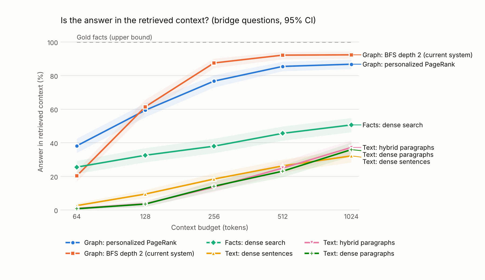
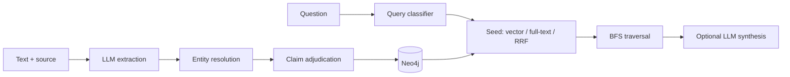

# GraphRAG Lab

A research testbed for GraphRAG: build a knowledge graph from text with an
LLM, then study how well different retrievers pull the right subgraph back
out for multi-hop questions.

The guiding question: **does the graph actually help, and can a learned
retriever choose better subgraphs than heuristics when the graph was built
by an LLM and is therefore noisy?** See the [research plan](docs/research-plan.md).

[](https://github.com/Pedro105/graphrag-retrieval-lab/actions/workflows/ci.yml)

## Status

| Milestone | State |
|---|---|
| 1. Cleanup: compose stack, CI, cached LLM client | Done |
| 2. Neo4j port + benchmark harness with baselines (2WikiMultiHopQA) | Done: [first results](#first-results) |
| 3. Learned GNN retriever (PyTorch Geometric) | Planned |
| 4. Robustness study under controlled graph noise | Planned |
| 5. Conflicting / evolving knowledge benchmark | Stretch |
| 6. Results report and interactive demo | Planned |

## First results

Retrieval on 1,000 [2WikiMultiHopQA](https://github.com/Alab-NII/2wikimultihop)
questions, against a pooled corpus of 24.8k paragraphs and a Neo4j graph of
21.3k facts (21.8k entities). Every retriever gets the same token budget, and
the metric is whether the answer ends up in the retrieved context.



| At 256 tokens | Answer in context (bridge questions, n=537) | Full chain retrieved (all, n=1000) |
|---|---|---|
| Text: hybrid paragraphs (dense + BM25) | 13.6% | 25.0% |
| Text: dense sentences | 18.4% | 25.1% |
| Facts: dense search, no structure | 38.0% | 41.7% |
| Graph: personalized PageRank | 76.7% | 67.4% |
| **Graph: BFS depth 2 (the system as built)** | **87.5%** | **80.8%** |
| Gold facts (upper bound) | 100% | 100% |

What it shows:

- **With a clean graph, graph retrieval wins by a wide margin.** Single-shot
  text retrieval finds the paragraph about the entity in the question but
  rarely the second-hop paragraph that holds the answer.
- **The structure does the work, not the fact format.** The same facts
  searched by embedding similarity reach only 38%.
- **No heuristic wins everywhere.** At 64 tokens PageRank's ranking is twice
  as good as unranked BFS (38% vs 20%); from 128 tokens on, BFS's hop order
  is better, likely because PageRank over-weights hub entities. Both are far
  from the 100% upper bound at small budgets, which is the target for the
  learned retriever.
- **Hardest case:** comparisons across two chains (four facts). The best
  method retrieves the full chain for only 44% of them.

Caveat: this is the *gold-graph* condition. The graph holds curated
Wikidata facts, standing in for perfect extraction, so it bounds what graph
retrieval can gain. How fast the advantage erodes under extraction errors is
milestone 4. Full tables (all budgets, 95% CIs, per question type), the
per-question data and the protocol: [`results/2wiki-dev/`](results/2wiki-dev/results.md),
[`docs/benchmark.md`](docs/benchmark.md). Reproduce with `make up && make bench`
(no API key needed).

## What the system does today



- **Extraction:** structured LLM output with open-vocabulary relations and
  assertion semantics (asserted / terminated / negated, `as_of`).
- **Entity resolution:** embedding similarity plus exact-name matching, with
  type treated as a soft signal and merge candidates recorded.
- **Reified claims:** every fact is a `:Claim` node with status
  (`active` / `superseded` / `disputed` / `retracted`), validity window,
  asserters and support count. New assertions are adjudicated against
  existing claims (corroborate, supersede, dispute, or independent) by
  deterministic rules, with an LLM judge only for the ambiguous case.
- **Hybrid retrieval:** vector and full-text seeds fused with reciprocal
  rank fusion, then multi-hop BFS over live claims; a query classifier
  picks the mode and depth.
- **Reproducibility:** every LLM call is cached on disk by a hash of its
  inputs and run at temperature 0, so reruns are free and identical.

Details: [architecture](docs/architecture.md) ·
[design decisions](docs/decisions/) ·
[query classifier notes](docs/classifier_notes.md).

## Quickstart

Requires Docker, Python 3.12 and [uv](https://docs.astral.sh/uv/). Ingesting
text needs an Anthropic key for extraction; embeddings run locally
(`BAAI/bge-small-en-v1.5`, downloaded on first use).

```bash
make install                 # uv sync
cp .env.example .env         # add ANTHROPIC_API_KEY
make up                      # Neo4j on :7687, browser on :7474
make api                     # API on :8000 (or: docker compose up -d)
```

Ingest two contradictory statements from different sources, then ask:

```bash
curl -s localhost:8000/v1/memories -H 'Content-Type: application/json' \
  -d '{"tenant_id": "demo", "source": "crm-agent",
       "content": "Maria Silva works at Helios Therapeutics."}'

curl -s localhost:8000/v1/memories -H 'Content-Type: application/json' \
  -d '{"tenant_id": "demo", "source": "hr-agent",
       "content": "Maria Silva works at Cascade Labs."}'

curl -s "localhost:8000/v1/conflicts?tenant_id=demo"      # the dispute, with asserters
curl -s localhost:8000/v1/recall -H 'Content-Type: application/json' \
  -d '{"tenant_id": "demo", "query": "Where does Maria Silva work?", "synthesise": true}'
```

Interactive API docs are at `http://localhost:8000/docs`.

## Development

```bash
make check              # ruff, mypy --strict, unit tests (offline)
make test-integration   # needs `make up`; LLM-backed tests also need API keys
make bench-smoke             # retrieval benchmark on 50 questions (no API key)
make populate && make eval   # synthetic 3-cluster graph + recall smoke eval
```

CI runs the lint, type and unit job, and the integration suite against a
Neo4j service container, including an end-to-end pipeline test that uses
the real embedding model with stubbed extraction, so it needs no API key.

## Repository layout

```
src/graphrag_lab/
  api/          FastAPI routes (ingest, recall, graph/claims/conflict inspection)
  core/         remember/recall orchestration, query classifier, synthesis, config
  extraction/   extraction prompt, schemas, call
  resolution/   entity resolution, claim adjudication
  retrieval/    rank fusion, BFS traversal
  graph/        GraphStore interface + Neo4j implementation (all Cypher)
  vector/       embedding providers
  llm/          cached structured LLM client
  models/       pydantic contracts between modules
  bench/        retrieval benchmark: data, retrievers, metrics, runner, reports
configs/bench/  benchmark run configurations
results/        committed benchmark runs (tables, figure, per-question data)
tests/          unit (offline) and integration (live Neo4j) suites
eval/           recall smoke eval over a synthetic graph
docs/           architecture, benchmark protocol, research plan, ADRs
```

## License

[MIT](LICENSE)
