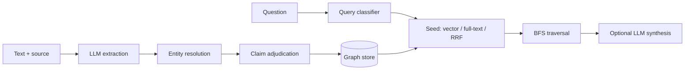

# Architecture

GraphRAG Lab turns free text into a knowledge graph and answers questions
by retrieving a subgraph. This document describes the system as it exists
today; [`research-plan.md`](research-plan.md) describes where it is going.

## Pipeline



### Write path (`core/service.py: remember`)

1. **Extraction** (`extraction/`). One structured LLM call turns the text
   into entities and typed relations. Relation names are open-vocabulary
   snake_case; each relation also carries an assertion type (`asserted`,
   `terminated`, `negated`), an optional `as_of` marker and a
   `replaces_hint`. The prompt is primed with predicates already in the
   graph so updates to a fact reuse its predicate.
2. **Entity resolution** (`resolution/entity_resolver.py`). Each extracted
   entity is embedded by name and matched against the graph's vector index:
   an exact normalized-name match always merges; otherwise the top candidate
   merges above a cosine threshold (0.92), with a small penalty when types
   disagree, and is recorded as a merge candidate above 0.80. Entity
   properties keep a per-source claim history (`models/claim.py`).
3. **Claim adjudication** (`resolution/conflict_resolver.py`). Every
   relation becomes a reified `:Claim` node. A new assertion is compared
   with active claims for the same subject and predicate:

   | Situation | Outcome |
   |---|---|
   | Terminated / negated | matching claim retracted |
   | Same object | corroboration (`support_count` + 1) |
   | Different object, recency signal, same asserter | supersede |
   | Different object, recency signal, other asserter | dispute |
   | Different object, no signal | LLM judge: independent / supersede / dispute |

   Claims are never deleted; superseded and retracted claims keep their
   validity window.

### Read path (`core/service.py: recall`)

1. **Routing** (`core/classifier.py`). A heuristic cascade classifies the
   query as `exact_lookup`, `single_hop` or `relational`, falling back to an
   LLM below a confidence threshold. The class picks the seeding mode and
   traversal depth. Callers can pin either knob to bypass routing.
2. **Seeding.** Vector similarity, full-text search, or both fused with
   reciprocal rank fusion (`retrieval/fusion.py`).
3. **Traversal** (`retrieval/traversal.py`). Undirected BFS over live
   claims to the chosen depth, capped at `max_entities`. The algorithm is a
   pure function over injected fetchers, so it is unit-tested without a
   database.
4. **Synthesis** (`core/synthesiser.py`, optional). The subgraph is
   serialized to text and an LLM writes an answer grounded in it, citing
   entity ids and flagging conflicting values.

## Graph model

```
(:Entity {id, name, entity_type, embedding, claims_json, ...})
(:Claim {id, predicate, status, asserted_by, support_count,
         valid_from, valid_to, supersedes, disputed_with, ...})
(:Claim)-[:SUBJECT]->(:Entity)
(:Claim)-[:OBJECT]->(:Entity)
```

Reifying facts as nodes lets status, validity and provenance live on the
fact itself instead of on a single edge (see
[ADR 0002](decisions/0002-graph-per-tenant-isolation.md) for isolation and
[ADR 0001](decisions/0001-falkordb-native-vector-index.md) for the vector
index). Each `tenant_id` is a separate FalkorDB graph, used to keep corpora
and experiments apart.

## LLM calls

All LLM use goes through `llm/client.py`: Instructor structured outputs at
temperature 0, cached on disk by a hash of model, prompts, parameters and
response schema ([ADR 0003](decisions/0003-cache-llm-calls-on-disk.md)).
Embeddings currently use OpenAI `text-embedding-3-small`.

## Modules

| Module | Responsibility |
|---|---|
| `api/` | FastAPI routes; no business logic |
| `core/` | Orchestration (`remember`/`recall`), query classifier, synthesis, config |
| `extraction/` | Prompt, schemas and the extraction call |
| `resolution/` | Entity resolution and claim adjudication |
| `retrieval/` | Rank fusion and BFS traversal |
| `graph/` | `GraphStore` interface and the FalkorDB implementation; all Cypher lives here |
| `vector/` | Embedding providers |
| `llm/` | Cached structured LLM client |
| `models/` | Pydantic contracts shared across modules |

Modules communicate only through the pydantic models in `models/`, and the
database sits behind the `GraphStore` interface, which is what makes the
planned Neo4j port a contained change.

## Known limitations

These are the motivation for the research plan rather than bugs to patch:

- Traversal does not rank what it returns: every neighbour up to the
  depth is included, so context size grows with graph density.
- Resolution thresholds, classifier confidences and the judge threshold are
  hand-set, not learned or measured.
- The existing eval (`eval/`) is an 11-case smoke test on a small synthetic
  graph; it cannot show whether the graph helps.
- Non-tenant scope keys and entity properties are stored as JSON strings,
  so they cannot be filtered in Cypher.
- Claim upserts are read-modify-write without a transaction, so concurrent
  writers can race.
